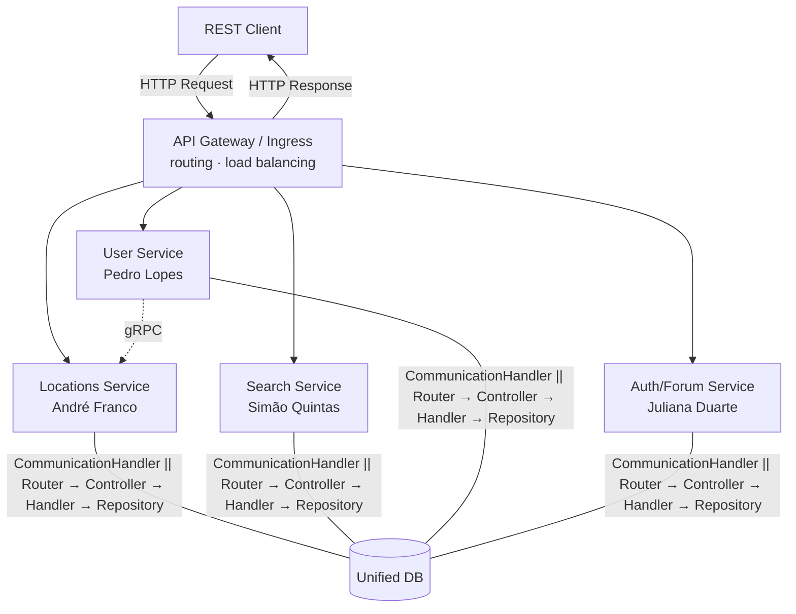

# Phase 3 – Functional Requirements and Application Architecture

**Project:** European Migration Assistant  
**Student:** André Franco – 59876

---

## 1. Functional Requirements

### FR1 – Check List of Countries/Cities

**A – Full listing**  
The system must return the complete list of European locations available on the platform.

**B – Information per location**  
Each entry in the list must include, at minimum, the internal ID, name, type (country or city) and code.

**C – Filtering by type**  
The system must support optional filtering by location type (country or city).

---

### FR2 – Check Data for a Country/City

**A – Detail by ID**  
The system must return all available statistical indicators for a location identified by its internal ID.

**B – Detail by ISO code**  
The system must return the same data when the location is identified by its ISO alpha-2 code.

**C – Indicator content**  
Each indicator must include the dataset name, numeric value, unit of measurement and reference year.

**D – Location not found**  
The system must return HTTP 404 if the location does not exist.

---

### FR3 – Comparison between Countries/Cities

**A – Side-by-side comparison**  
The system must accept two or more location IDs and return their indicators side by side in a single response.

**B – Filtering by dataset**  
The system must support optional filtering by specific datasets; if omitted, all available indicators are returned.

**C – Parameter validation**  
The system must return HTTP 400 for invalid or missing parameters, and HTTP 404 if one or more locations are not found.

---

### FR4 – Top by Metric

**A – Ordering by metric**  
The system must return a list of locations ordered by a specific dataset, in ascending or descending order.

**B – Result limit**  
The system must support an optional result limit parameter (between 1 and 15), with a default value of 5.

**C – Response content**  
Each entry must include the ranking position, the location summary and the corresponding indicator.

**D – Parameter validation**  
The system must return HTTP 400 if the dataset is invalid or not provided.

---

## 2. Application Architecture ##

### 2.1 Overview ##

Note: Initial Architecture Proposal

The application is composed of four "domains" with independent microservices, all exposed through a single API Gateway / Ingress. Each microservice is autonomous - it contains its own internal layers (router, controller, handler, repository) that are started simultaneously. This separation ensures that each service can be developed, tested, deployed and scaled independently of the others.

The services are grouped into two domains: the locations domain, which aggregates geographic and statistical data, and the users domain, which manages profiles and interactions.

The API Gateway is the only component exposed externally, acting as a single entry point and abstracting the internal structure of the application from the client. It is responsible for routing requests to the correct service based on the path, and for load balancing between replicas of the same service. Routing within each service - between its internal endpoints - is the responsibility of that service's own router.

### 2.2 Components ##

| Component | Responsible | Responsibility |
| --- | --- | --- |
| API Gateway / Ingress | Group | External routing to the correct service; load balancing between replicas |
| Locations Service | André Franco | List, detail, compare and rank locations |
| Search Service | Simão Quintas | Filtered search, historical data, comparisons |
| User Service | Pedro Lopes | User profiles, favourites, personalised recommendations |
| Auth/Forum Service | Juliana Duarte | Registration, authentication, forum posts |
| DB | Group | Stores locations, statistical indicators (Eurostat/EEA), Users and Forums in separate tables |

### 2.3 Architecture Diagram ###

### 2.4 Legend ###

**REST Client** - External client that interacts with the application through HTTP requests.

**API Gateway / Ingress** - Single entry point for all external requests. Routes each request to the correct service based on the path (e.g.: `/api/v1/locations` → Locations Service), and distributes the load between replicas of the same service when multiple instances are running. Kubernetes Ingress can be used.

**Locations Service** - Service responsible for use cases related to locations: listing, querying indicators, side-by-side comparison and ranking by metric. Internally composed of router, controller, handler and repository, operating exclusively on the locations domain.

**Search Service** - Service responsible for filtered location search and querying historical data.

**User Service** - Service responsible for managing user profiles, favourite destinations, metric importance and personalised recommendation lists.

**Auth/Forum Service** - Service responsible for user registration and authentication, account deletion and forum post management.

**Unified DB** - Relational database that stores locations, respective statistical indicators from the datasets, user accounts, sessions, metric preferences and forum posts.

**Eurostat / EEA** - External data sources. The datasets are ingested into the DB at service startup through a loading script.

**Inter-service Communication** - Communication via gRPC, using the CommunicationHandler to receive messages and send responses.

### 2.5 Design Decisions ###

- **Microservices per domain** - one service per group member, deployable and developed independently.
- **Unified database** - due to data overlap between services.
- **REST over HTTP** - all communication between client and services.
- **Single Ingress** - only the gateway is exposed externally; all services and databases are internal.
- **Dataset ingestion** - Eurostat/EEA CSV files are loaded into the database at container startup.

### 2.6 Possible Changes ###

If microservices need to communicate with each other in the future, the "stack" structure becomes quite inefficient and convoluted. As such, a more scalable alternative solution has been developed (but consequently more complex and with a higher initial development cost) that can easily be implemented in the future:

- The stack ceases to exist as a unified entity, and each of its components (Controller, Handler and Data Access) can be initialised individually and without having a One-to-One relationship with the component in the layer above.
- The components, now independent, will need to communicate with each other through an RPC, in order to avoid the complications that HTTP communication between backend processes brings.
- This implementation may help increase scalability, but may introduce greater initial complexity, as well as introducing a possible bottleneck in the form of communication between components (which were previously all initialised together in the same process). It is an option to consider depending on the circumstances we may encounter in the production phase.
- The transition between the current architecture and this alternative would be relatively easy, requiring only connecting the components through RPC and allowing individual deployment, so it would be a low-cost transition.
