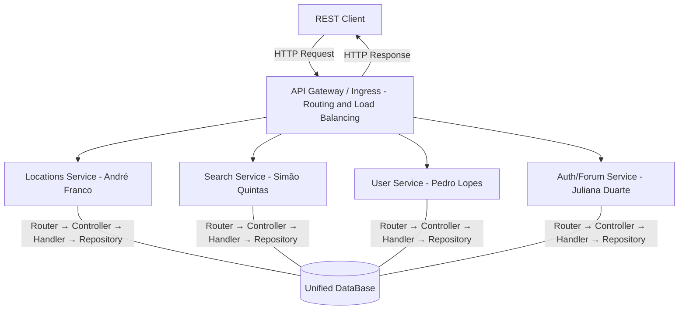

# Phase 3 – Functional Requirements and Application Architecture

**Project:** European Migration Assistant  
**Student:** Juliana Duarte - 60807

---

## 1. Functional Requirements

### FR1 – Register User

**A – Required fields**  
The system must allow the registration of users with username and email, ensuring data uniqueness.

**B – Data validation**  
Name, email and password must be mandatory fields in the registration request.

**C – Data validation**  
The system must validate that the email is in a valid format.

**D – Email uniqueness**  
The system must not allow the registration of two accounts with the same username or the same email address.

**E – Success response**  
On success, the system must create the user account and return their basic data.

**F – Error validation**  
The system must return HTTP 400 for invalid or missing data, and HTTP 409 if the username or email are already registered.

---

### FR2 – User Login

**A – Authentication by credentials**  
The system must allow simplified user authentication through the combination of username and email.

**B – Data validation**  
The system must verify whether the provided data corresponds to an existing account.

**C – Success response**  
After successful authentication, the system must return the user's basic data.

**D – Response content**  
The response must include, at minimum, the user ID, username and email.

**E – Invalid data**  
The system must reject identification attempts with a non-existent username or email, or whose combination does not correspond to a registered account.

**F – Error validation**  
The system must return HTTP 400 for missing fields and HTTP 401 if the user is invalid.

---

### FR3 – Delete Account

**A – Account removal**  
The system must allow the deletion of an existing user account.

**B – User identification**  
Account deletion must be performed based on the user identifier.

**C – Operation confirmation**  
After successful deletion, the system must confirm that the account has been removed.

**D – Effect of the operation**  
After deletion, the account can no longer be used in future operations on the application.

**E – Type of removal** 
Account deletion must be logical, preserving the user record in the database with an inactive status.

**F – Error validation**  
The system must return HTTP 404 if the account does not exist.

---

### FR4 – Post in Forums

**A – Post creation**  
The system must allow an existing user to create a post in the forum.

**B – Minimum post content**  
Each post must include, at minimum, title, textual content, author and creation date.

**C – Association to the user**  
Each post must be associated with the authenticated user who created it.

**D – Post persistence**  
After successful creation, the post must be stored and available for viewing in the forum.

**D – Error validation**  
The system must return HTTP 400 for missing required fields and HTTP 401 if the associated user does not exist.

---
### FR5 – View Forum Posts

**A – Post listing**  
The system must allow viewing of existing posts in the forum.

**B – Post ordering**  
Posts must be presented in chronological order, from most recent to oldest.

**C – Response content**  
Each returned post must include, at minimum:

- Post ID
- title
- textual content
- author
- creation date

**D – Access to viewing**  
Viewing forum posts can only be performed by existing users.

**D – Error validation**  
The system must return HTTP 404 if no posts are available.

---

## 2. Application Architecture ##

### 2.1 Overview ##

Note: Initial Architecture Proposal

The application is composed of four "domains" with independent microservices, all exposed through a single API Gateway / Ingress. Each microservice is autonomous - it contains its own internal layers (router, controller, handler, repository) that are started simultaneously. This separation ensures that each service can be developed, tested, deployed and scaled independently of the others.

The services are grouped into two domains: the locations domain, which aggregates geographic and statistical data, and the users domain, which manages profiles and interactions.

The API Gateway is the only component exposed externally, acting as a single entry point and abstracting the internal structure of the application from the client. It is responsible for routing requests to the correct service based on the path, and for load balancing between replicas of the same service. Routing within each service - between its internal endpoints - is the responsibility of that service's own router.

### 2.2 Components ##

| Component | Responsible | Responsibility |
| --- | --- | --- |
| API Gateway / Ingress | Group | External routing to the correct service; load balancing between replicas |
| Locations Service | André Franco | List, detail, compare and rank locations |
| Search Service | Simão Quintas | Filtered search, historical data, comparisons |
| User Service | Pedro Lopes | User profiles, favourites, personalised recommendations |
| Auth/Forum Service | Juliana Duarte | Registration, authentication, forum posts |
| DB | Group | Stores locations, statistical indicators (Eurostat/EEA), Users and Forums in separate tables |

### 2.3 Architecture Diagram ###

### 2.4 Legend ###

**REST Client** - External client that interacts with the application through HTTP requests.

**API Gateway / Ingress** - Single entry point for all external requests. Routes each request to the correct service based on the path (e.g.: `/api/v1/locations` → Locations Service), and distributes the load between replicas of the same service when multiple instances are running. Kubernetes Ingress can be used.

**Locations Service** - Service responsible for use cases related to locations: listing, querying indicators, side-by-side comparison and ranking by metric. Internally composed of router, controller, handler and repository, operating exclusively on the locations domain.

**Search Service** - Service responsible for filtered location search and querying historical data.

**User Service** - Service responsible for managing user profiles, favourite destinations, metric importance and personalised recommendation lists.

**Auth/Forum Service** - Service responsible for user registration and authentication, account deletion and forum post management.

**Unified DB** - Relational database that stores locations, respective statistical indicators from the datasets, user accounts, sessions, metric preferences and forum posts.

**Eurostat / EEA** - External data sources. The datasets are ingested into the DB at service startup through a loading script.

**NOTE** - Services are not expected to communicate with each other. If this becomes necessary in the future, changes described at the end of this file may need to be made.
Additionally, there may be overlapping between domains, which may reduce the number of different services developed.

### 2.5 Design Decisions ###

- **Microservices per domain** - one service per group member, deployable and developed independently.
- **Unified database** - due to data overlap between services.
- **REST over HTTP** - all communication between client and services.
- **Single Ingress** - only the gateway is exposed externally; all services and databases are internal.
- **Dataset ingestion** - Eurostat/EEA CSV files are loaded into the database at container startup.

### 2.6 Possible Changes ###

If microservices need to communicate with each other in the future, the "stack" structure becomes quite inefficient and convoluted. As such, a more scalable alternative solution has been developed (but consequently more complex and with a higher initial development cost) that can easily be implemented in the future:

- The stack ceases to exist as a unified entity, and each of its components (Controller, Handler and Data Access) can be initialised individually and without having a One-to-One relationship with the component in the layer above.
- The components, now independent, will need to communicate with each other through an RPC, in order to avoid the complications that HTTP communication between backend processes brings.
- This implementation may help increase scalability, but may introduce greater initial complexity, as well as introducing a possible bottleneck in the form of communication between components (which were previously all initialised together in the same process). It is an option to consider depending on the circumstances we may encounter in the production phase.
- The transition between the current architecture and this alternative would be relatively easy, requiring only connecting the components through RPC and allowing individual deployment, so it would be a low-cost transition.
